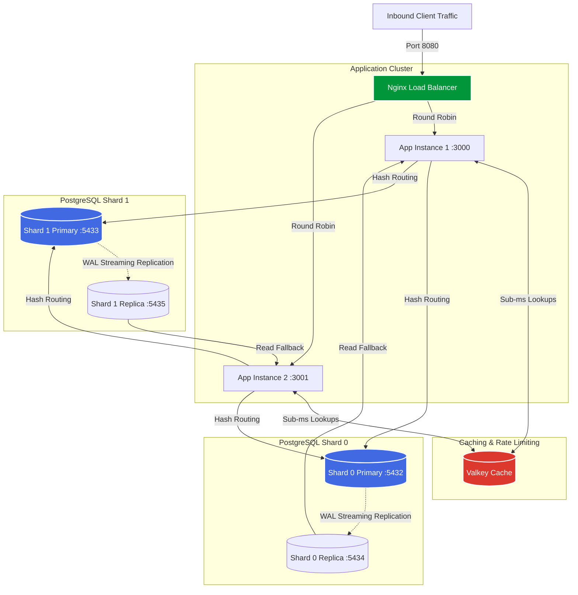

# ⚡ LinkShrink: High-Throughput Sharded URL Engine

<div align="center">

[](https://nodejs.org/)
[](https://www.postgresql.org/)
[](https://valkey.io/)
[](https://nginx.org/)
[](https://k6.io/)
[](LICENSE)

**An ultra-resilient, horizontally sharded, memory-cached, and replicated edge URL redirection service engineered for maximum throughput on resource-constrained hardware.**

</div>

---

## 🚀 Architecture Highlights

LinkShrink is designed to push bare-metal edge hardware (e.g. an Android chroot or compact Linux server) to its physical limits. Rather than a monolithic server, it deploys:
1. **Nginx Reverse Proxy & Load Balancer:** Distributes incoming traffic across multiple independent Node.js application instances.
2. **Dual-Shard PostgreSQL Topology:** Shards data across 4 database clusters:
   - **Shard 0:** Primary (port `5432`) + Streaming Read Replica (port `5434`).
   - **Shard 1:** Primary (port `5433`) + Streaming Read Replica (port `5435`).
3. **In-Memory Valkey Cache:** Sub-millisecond redirect lookups with TTL caching and token-bucket creation rate-limiting.
4. **Live Telemetry HUD (`monitor/dashboard.html`):** Real-time dashboard graphing requests per second, cache hit ratio, system memory, and CPU temperature.

---

## 🏛️ Topology Diagram



---

## 📦 Directory Structure

```
├── chaos/                  # Failure testing & replica promotion scripts
│   ├── kill-and-promote.sh # Simulates primary node failure & failover
│   └── README.md           # Failure analysis & recovery documentation
├── infra/                  # Provisioning & system services
│   ├── nginx.conf          # Upstream proxy & load balancing rules
│   ├── provision.sh        # Automated setup (Postgres, Valkey, Nginx, Node)
│   ├── setup-shards.sh     # 4-cluster PostgreSQL shard provisioning
│   ├── start-all.sh        # Orchestrated daemon launcher (tmux session)
│   └── zrok/               # Public tunnel relay configuration
├── load-test/              # Performance benchmarking suite
│   └── redirects.js        # k6 load testing script for high-concurrency redirects
├── monitor/                # Real-time monitoring dashboard
│   └── dashboard.html      # Client HUD for latency, RPS, & thermal stats
├── src/                    # Core application source code
│   ├── cache.js            # Valkey caching & rate-limit driver
│   ├── db.js               # Multi-pool database abstraction
│   ├── server.js           # Express REST API routes & health probes
│   └── shardRouter.js      # Deterministic hash ring shard resolver
├── .env.example            # Environment template
└── schema.sql              # Base database schema
```

---

## 🛠️ Setup & Deployment

### 1. Automated Provisioning (Linux / Chroot as Root)
```bash
chmod +x infra/*.sh
./infra/provision.sh
```
This script automates:
- Package installation (`postgresql`, `valkey-server`, `nginx`, `nodejs`, `tmux`).
- Creation of the 4 independent PostgreSQL database clusters.
- Configuration of replication privileges and WAL streaming.
- Nginx upstream site enablement.

Verify all 4 clusters are online:
```bash
pg_lsclusters
```

### 2. Configure Environment & Start Services
```bash
cp .env.example .env
# Edit .env with your chosen credentials

npm install
./infra/start-all.sh
```

---

## 📡 API Reference

### 1. Create Short Link
```http
POST /api/shorten
Content-Type: application/json

{
  "url": "https://example.com/very/long/target/url"
}
```

**Response (`201 Created`):**
```json
{
  "short_code": "aB3xY9",
  "shard": 0,
  "short_url": "http://<host>:8080/aB3xY9",
  "long_url": "https://example.com/very/long/target/url"
}
```

### 2. Redirect to Target URL
```http
GET /:short_code
```
- First hit: Serves from Shard Read Replica, populates Valkey in-memory cache.
- Subsequent hits: Serves directly from Valkey (<1ms latency).

### 3. Query Link Analytics
```http
GET /api/stats/:short_code
```

**Response (`200 OK`):**
```json
{
  "short_code": "aB3xY9",
  "shard": 0,
  "long_url": "https://example.com/very/long/target/url",
  "click_count": 1420,
  "created_at": "2026-10-14T18:00:00.000Z"
}
```

---

## ⚡ Concurrency & Chaos Testing

### Load Testing with k6
Execute the high-concurrency redirection test suite:
```bash
k6 run --env BASE_URL=http://<host-ip>:8080 load-test/redirects.js
```

### Chaos Engineering (Replica Promotion)
Simulate catastrophic failure of Shard 0's primary:
```bash
./chaos/kill-and-promote.sh
```
Watch how write operations fail safely while cached redirects continue serving uninterrupted, followed by manual replica promotion to restore full primary write capabilities.

---

## 📄 License

This repository is licensed under the MIT License. See [LICENSE](LICENSE) for details.
